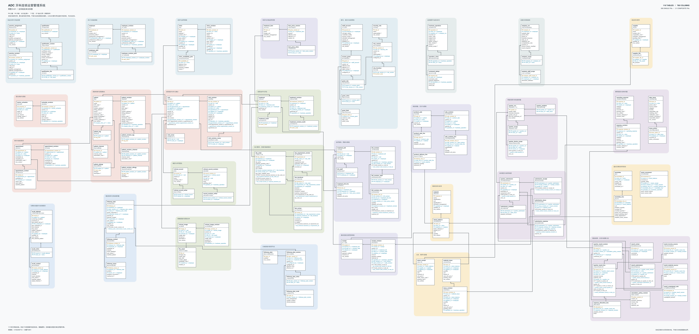

# ADC牙科连锁运营管理系统

系统分析与设计课程项目，以日常就诊、诊疗收费和物资业务形成的可追溯资料为基础，支持总部核对并确认牙医季度业绩，覆盖患者预约与取消、排班接诊、临床影像、义齿加工、诊后随访、经营查询及访问管理。

## 在线演示

- [患者预约页](https://101.33.215.169/?view=patient)可直接查询医生和可约时段。当所选日期无可约时段时，可以查找最近的可约日期。当前月度演示排班覆盖 2026 年 11 月 23 日至 12 月 22 日。
- [员工工作台](https://101.33.215.169/)按登录岗位显示可用功能，包括预约排班图、实际接诊及诊所设置。
- [网页与 API 源码及本地运行说明](app/README.md)。在线演示使用合成资料。

在患者端或员工端打开登录框，点「账号」栏选择演示身份，再提交登录。患者端可选「演示患者」，员工端可选「东城前台」或「东城医生」。三个身份均可从上方链接直接进入，无需输入密码。

若GitHub无法在线预览大PDF，可点击文件的下载按钮，在本地PDF阅读器中查看；也可使用 **Code → Download ZIP** 下载整个仓库。

## 配套资料

- [实地调研记录与现场照片](research/README.md)
- [完整数据字典与约束](docs/data-dictionary.md)
- [分析类与存储表追溯](docs/model-traceability.md)
- [32个用例的分析交互与主要数据表](docs/use-case-data-map.md)
- [ERD引用与导航说明](docs/erd-references.md)
- [全用例验收计划](docs/acceptance-plan.md)
- [设计与实现状态说明](docs/implementation-gaps.md)
- [文件清单与SHA-256校验值](FILES.sha256)

## 完整设计范围

32个系统用例、83个分析类（9边界、32控制、42实体）、408项分析操作、98项领域关联、52张分析序列图和10组状态机。数据层116表866列，321项单列引用和29项组合引用。开发依据保留全部操作与字段，展示选编不会反向删除功能。

患者预约由系统检查后直接生效，符合规则可自助改约或取消；前台登记真实到院、接诊开始、结束和离开，医生确认临床内容。UC11参考价维护与UC12医护开单分开；UC25由诊所管理人员提交，财务核算、总部复核。收款与商品实际交付分开，实际交付才作用库存。季度核算保留原范围、来源版本和首次完成时刻。

## 资料范围

本仓库包含课程设计产出、网页与 API 源码及已公开的 5 张调研照片，封面保留姓名、学号和班级。教师课件、参考书和案例原件、原始访谈全文及录音、运行数据库与账号凭据均为离库资料。现场照片保留画面，公开副本已清除定位和设备等嵌入元数据。

旧版文档已在当前分支替换；Git提交历史仍可追溯此前版本。
