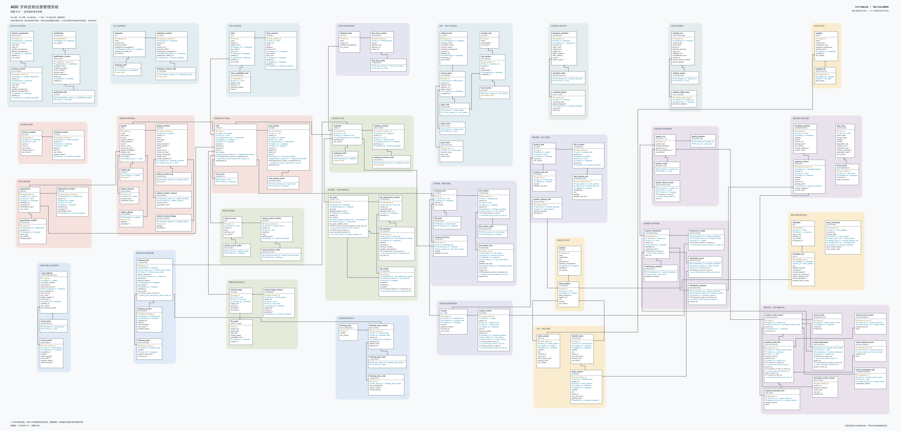

# ADC牙科连锁运营管理系统

系统分析与设计课程项目。系统以日常诊疗、收费和物资业务形成的可追溯资料为基础，支持总部核对并确认牙医季度业绩，同时覆盖预约排班、临床影像、义齿加工、随访邀约、经营分析及访问管理。

**当前交付为分析与设计文档，尚未实现可运行系统。** 本仓库不是实际诊所数据库，不包含真实患者数据；文档中的页面原型和验收场景不代表系统已经运行或通过测试。

## 阅读顺序

| 文件 | 内容 |
| --- | --- |
| [A至C正文](docs/ADC-ABC.pdf) | 愿景、业务用例、现状及改进业务序列、系统用例和规约、分析类图、分析序列图、状态机；374页 |
| [D设计正文](docs/ADC-D-design.pdf) | 总体设计、数据层、业务层、表示层、跨层协作、实施与验收计划、完整数据字典；229页 |
| [全系统ERD](diagrams/ADC-ERD.pdf) | 独立单页大幅矢量图，请放大查看，不宜缩成A4打印 |
| [ERD可编辑SVG](diagrams/ADC-ERD.svg) | 与ERD PDF配套的矢量图源 |

若GitHub提示PDF无法在线预览，可打开文件后选择下载，在本地PDF阅读器中查看。下载整个仓库时，可使用 **Code → Download ZIP**。

## 配套资料

- [完整逻辑数据字典与约束](docs/data-dictionary.md)
- [分析实体、属性及关联到数据层的追溯](docs/model-traceability.md)
- [37个用例的主要数据读写与页面索引](docs/use-case-data-map.md)
- [ERD引用和导航登记](docs/erd-references.md)
- [验收计划与质量指标](docs/acceptance-plan.md)
- [待实现和验证事项](docs/implementation-gaps.md)
- [文件清单与SHA-256校验值](FILES.sha256)

## 模型规模与业务边界

当前包含37个系统用例、91个分析类、848项分析操作及12个业务状态机。数据层为116张候选表、768列、285项单列外键、21项组合外键；逻辑结构仍需在实际数据库选型后形成并验证迁移与约束。

前台依据实际反馈登记到院、接诊开始、结束和离开；医生确认临床内容。收款与商品交付分开，只有实际交付才扣减相关库存。季度业绩固定采用的完整范围、来源版本和核算口径，不以后来更正覆盖旧版依据。

## 后续开发

完成技术选型后，逐步实现数据库、业务服务和页面，并执行权限、版本冲突、重复提交、库存、季度核算及恢复测试。当前验收计划均待运行验证，不把设计检查等同系统验收。

## 资料范围

本仓库仅收录课程项目产出，不包含教师课件、参考书和案例原文件、原始访谈录音或全文、内部讨论、历史草稿、临时渲染或凭据。参考学习不代表获得原资料的公开再分发许可。
