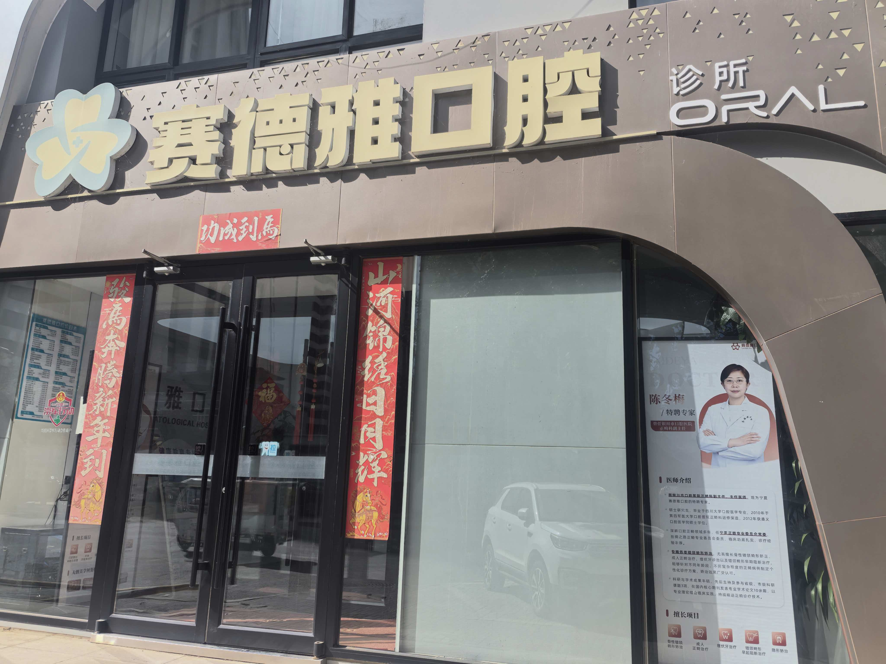
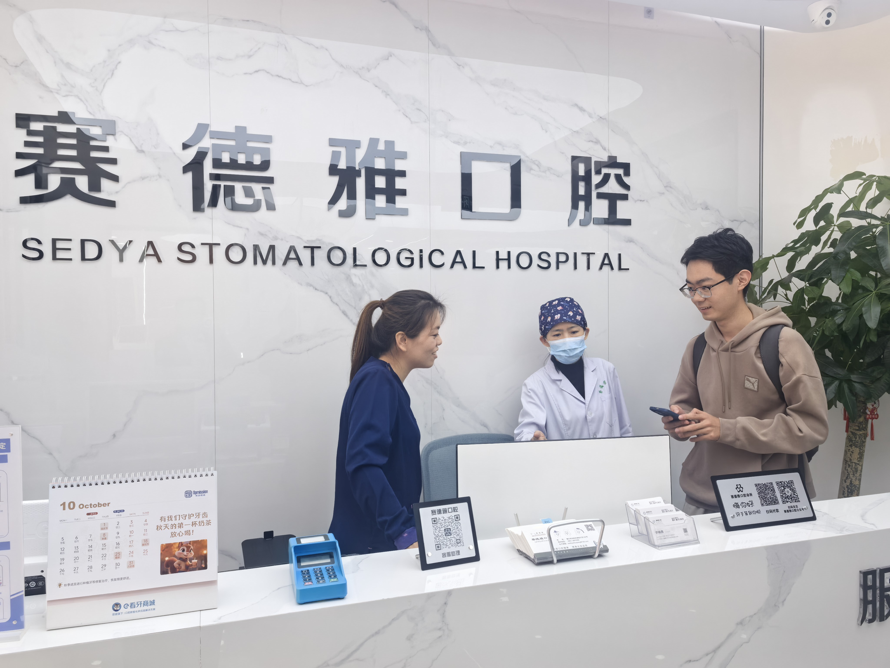
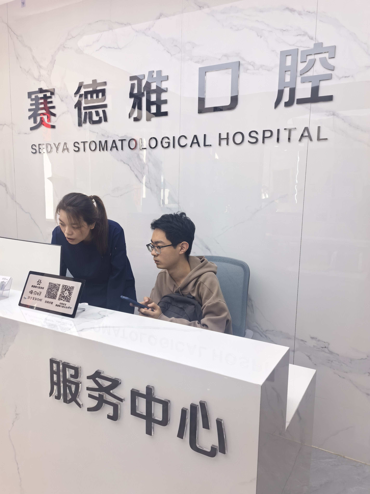
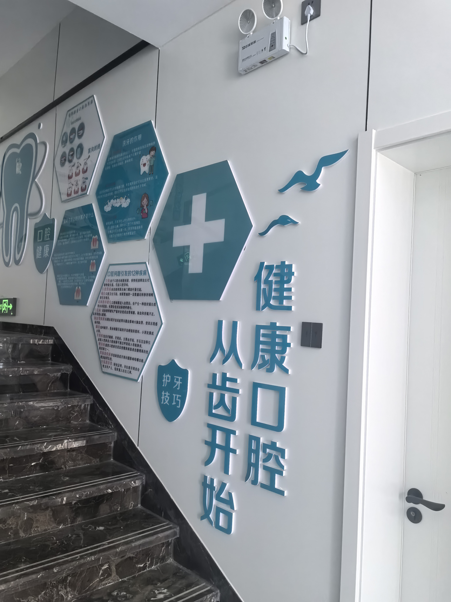
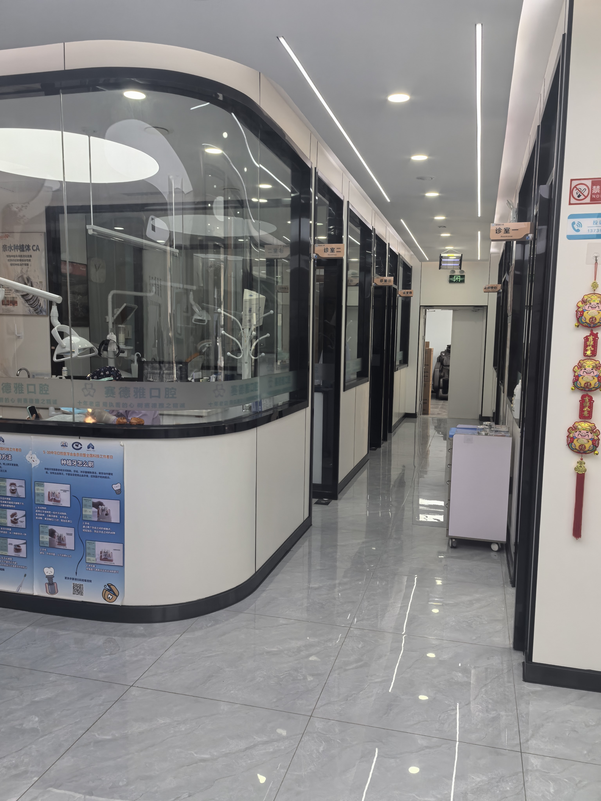

# 实地调研记录

本目录收录课程项目实地调研的5张现场照片，展示赛德雅口腔的门店、前台交流场景及诊疗环境，为理解口腔诊所的实际工作场景提供补充材料。

实地调研地点与课程案例中的ADC牙科连锁组织不同。照片用于记录现场场景，不将该门店直接等同于ADC，也不单凭照片认定岗位职责、软件功能或季度核算规则；具体需求及设计见[A至C正文](../docs/ADC-ABC.pdf)。

## 照片索引

| 编号 | 内容 | 文件 |
| --- | --- | --- |
| R01 | 门店外观与入口标识 | [查看原尺寸照片](photos/01-clinic-exterior.jpg) |
| R02 | 前台现场交流，全景 | [查看原尺寸照片](photos/02-reception-discussion.jpg) |
| R03 | 前台现场交流，另一视角 | [查看原尺寸照片](photos/03-reception-discussion-detail.jpg) |
| R04 | 楼梯及口腔健康科普墙 | [查看原尺寸照片](photos/04-oral-health-display.jpg) |
| R05 | 诊室走廊与诊疗环境 | [查看原尺寸照片](photos/05-treatment-corridor.jpg) |

## 现场照片

### R01 门店外观

### R02 前台现场交流

### R03 前台交流另一视角

### R04 口腔健康科普墙

### R05 诊疗环境

## 文件处理说明

公开副本保留照片画面、人脸及原始分辨率，未进行AI重绘、裁剪或人脸遮挡；仅清除GPS定位、拍摄设备、拍摄时间、嵌入缩略图等元数据和附加数据，不重新压缩主图。原始照片保留在本地，未随本次更新上传。照片日期与人物身份未在本目录作额外推定。

[返回项目首页](../README.md)
